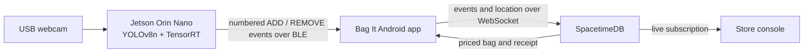

# Bag It — a bag that checks you out

Bag It is our Cal Hacks 13.0 prototype for checkout-free grocery shopping. Put an item into the bag and it appears in the phone app with that store's price. Take it back out and the total falls. The phone uses location to recognize the store and completes the trip when the shopper leaves, without a checkout button.

The prototype's card payment is **simulated**; it does not move real money. See the [judging guide](https://www.mana.space/home/JVe6HRQkCcQDCaSb9t5kMPKiY3j1/apps/smart-bag-judging) for the demo flow.

## How it works



1. **The bag sees an item.** A Logitech webcam feeds pretrained YOLOv8n on the Jetson. The scanner tracks products across a horizontal bag-opening boundary: down emits `ADD`, up emits `REMOVE`. A JSON product list limits the detectable COCO classes. It tolerates short detection gaps and does not count an object merely disappearing.
2. **Bluetooth tells the phone.** The Jetson sends numbered events over a BLE GATT service. The Android app reconnects, deduplicates by session and sequence, and acknowledges events after the backend processes them.
3. **The phone knows the store.** Bag It uses location to start and end shopping sessions. Its SpacetimeDB client sends hardware events over one WebSocket; the backend maps each detected label to a store product and price.
4. **Leaving finishes the trip.** The backend completes the bag and receipt in one transaction when the phone confirms the shopper has left the store. The app shows the receipt and exit code; the store console updates through a live subscription.

## Repository guide

| Path | What is here |
| --- | --- |
| [`hardware/`](hardware/README.md) | Windows YOLO camera test, Jetson native TensorRT scanner, tracking, crossing events, HTTP test preview, and hardware tests |
| [`data/`](data/) | Product whitelist and normalized bag-opening geometry |
| [`hardware/smartcart_ble/`](hardware/smartcart_ble/README.md) | BLE transport used by the scanner; the shared wire contract is in [`docs/SMARTCART-BLE.md`](docs/SMARTCART-BLE.md) |
| [`android/`](android/README.md) | Kotlin/Jetpack Compose shopper app, BLE cart client, location, wallet, and receipts |
| [`ios/`](ios/README.md) | SwiftUI iPhone app source and setup instructions |
| [`console/`](console/README.md) | Mana store console with live SpacetimeDB subscriptions |
| [`firmware/`](firmware/README.md) | ESP32 BLE bag firmware and status-light protocol |
| [`website/`](website/README.md) | Static Bag It site and demo media |
| [`smartcart-ble/`](smartcart-ble/README.md) | Standalone copy of the Jetson BLE package and its tests |

## Try the camera scanner on Windows

Follow the [hardware setup guide](hardware/README.md) to prepare the Python environment and install dependencies. From Git Bash at the repository root, with the USB webcam on source `1`:

```bash
./.venv/Scripts/python.exe -m hardware.main --source 1 --confidence 0.4 --width 640 --height 480 --fps 30 --imgsz 416 --headless --http-port 8080 --transport console
```

Open <http://127.0.0.1:8080/> in Chrome for the annotated camera view. The terminal prints confirmed JSON events. Change `--source` for another camera index; press Ctrl+C to stop. This HTTP preview is a local development aid. The Jetson's production event path is BLE, and its native TensorRT launch and deployment instructions are in [hardware/README.md](hardware/README.md).

Run the hardware unit tests from the same directory:

```bash
./.venv/Scripts/python.exe -m unittest discover -s hardware/tests -q
```

The camera needs to see an item clearly on **both sides** of the divider to confirm a crossing. Camera capture FPS and model inference FPS are reported separately; requesting 30 camera FPS does not guarantee 30 detection updates per second.
